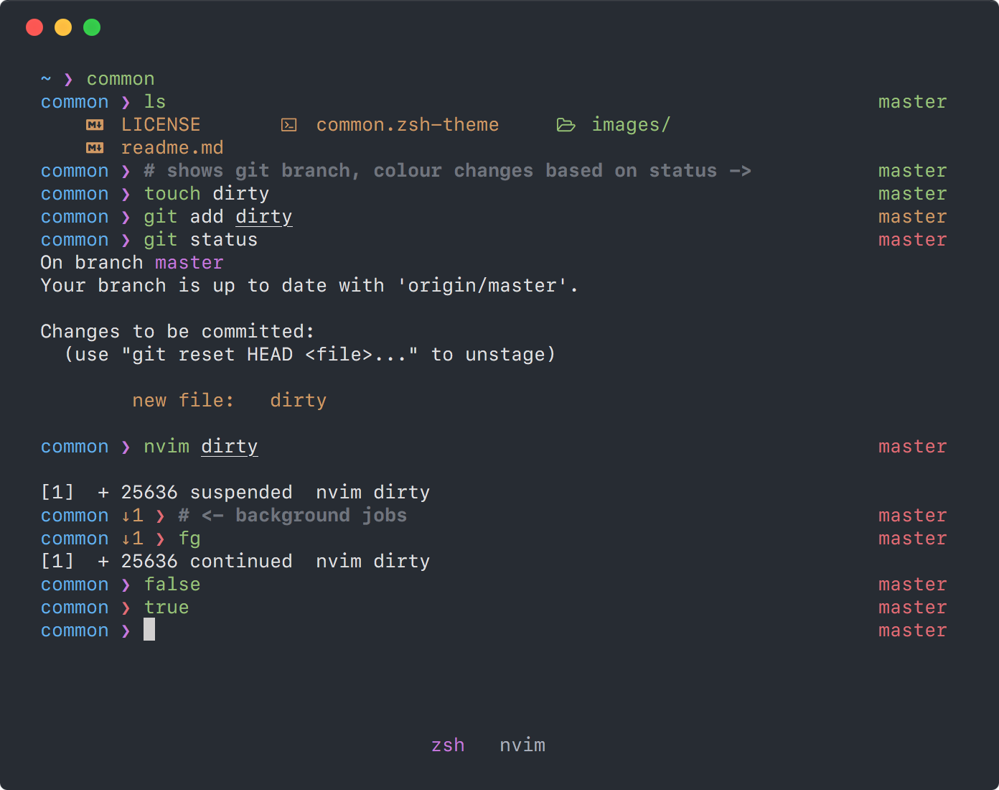

<p align="center">
  
</p>
<p align="center">A simple, clean and minimal Zsh prompt.</p>

<p align="center"></p>

- Current working directory
- Hostname (shown in remote SSH shells only)
- AWS Vault role
- Background jobs
- Current SHA (optional)
- Exit status of the last command
- Git branch and staged, unstaged, and untracked counts
- Customisable colours and symbols
- Optional asynchronous Git status

## Requirements

- Zsh 5.2 or newer
- Git
- Oh My Zsh, or another setup that provides its colour definitions
- [`zsh-async`](https://github.com/mafredri/zsh-async) (optional, for non-blocking Git status)

## Installation

### Oh My Zsh

Download the theme, set it as the active Oh My Zsh theme, and restart Zsh:

```sh
mkdir -p "${ZSH_CUSTOM:-$HOME/.oh-my-zsh/custom}/themes" && curl -fsSL https://raw.githubusercontent.com/jackharrisonsherlock/common/master/common.zsh-theme -o "${ZSH_CUSTOM:-$HOME/.oh-my-zsh/custom}/themes/common.zsh-theme" && omz theme set common && exec zsh
```

## Asynchronous Git status

Common works without additional dependencies. By default it uses `zsh-async` when the plugin has already been loaded, and falls back to synchronous Git status otherwise.

To use asynchronous status, load `zsh-async` before Common. To force synchronous status, set this before loading the theme:

```zsh
COMMON_GIT_ASYNC=false
```

## Configuration

Set options before loading Common. The examples below show the defaults:

```zsh
COMMON_PROMPT_SYMBOL="❯"

COMMON_COLORS_HOST_ME=green
COMMON_COLORS_HOST_AWS_VAULT=yellow
COMMON_COLORS_CURRENT_DIR=blue
COMMON_COLORS_RETURN_STATUS_TRUE=magenta
COMMON_COLORS_RETURN_STATUS_FALSE=yellow
COMMON_COLORS_GIT_STATUS_DEFAULT=green
COMMON_COLORS_GIT_STATUS_STAGED=red
COMMON_COLORS_GIT_STATUS_UNSTAGED=yellow
COMMON_COLORS_GIT_PROMPT_SHA=green
COMMON_COLORS_BG_JOBS=yellow

COMMON_GIT_STAGED_SYMBOL="+"
COMMON_GIT_UNSTAGED_SYMBOL="!"
COMMON_GIT_UNTRACKED_SYMBOL="?"
COMMON_GIT_ASYNC=true
```

Git state is displayed explicitly as well as with colour. For example, `main +2 !1 ?3` means two staged changes, one unstaged change, and three untracked files. A staged or mixed repository is red, an unstaged or untracked repository is yellow, and a clean repository is green.


## Terminal

The screenshot shows Common in [Hyper](https://hyper.is/) with a [custom theme](https://github.com/jackharrisonsherlock/dotfiles/blob/master/dots/.hyper.js) and [SF Mono](https://developer.apple.com/fonts/).
